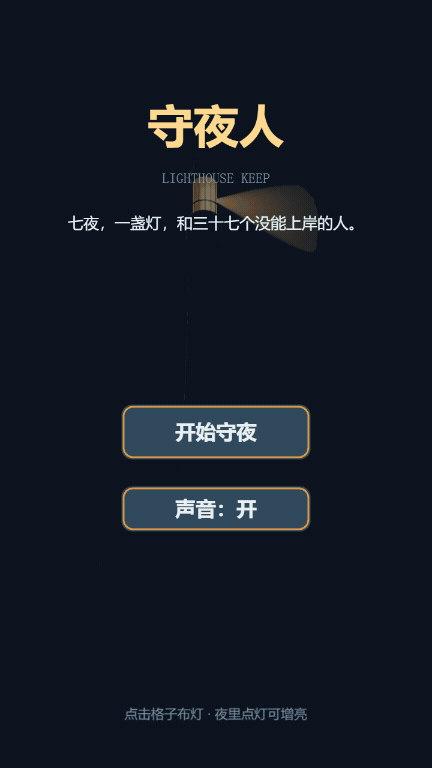
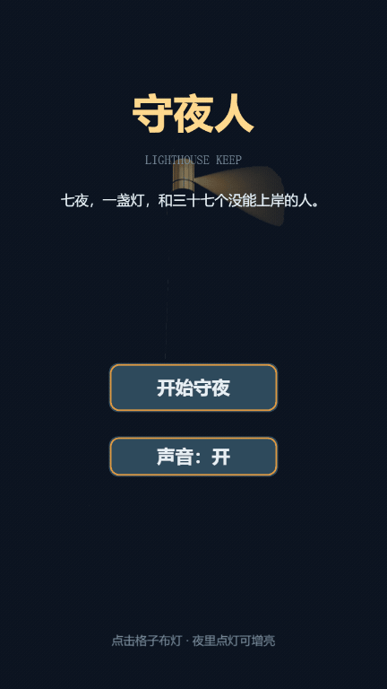

# IdeaToGame

**把一句游戏想法，端到端做成能上架的小游戏 —— 而且是有内容的那种。**

从 `一句话` 到 `可提交的 HTML5 包`：立项、玩法、AI 美术、分层音频、过审自检全自动。
需要人做的只有三件事：确认平台、确认方向、确认风格。

---

## 它解决什么

| | |
|---|---|
| **能出货** | 12 个能力环节串成流水线，一条命令出包 + 过审清单。5 个平台（CrazyGames / Poki / GameDistribution / Playgama / TapTap），体积按最严口径控制 |
| **值得玩** | 内容丰富度四维门禁（玩法 30 / 叙事 25 / 美学 25 / 音频 20）。机制必须互相咬合，故事必须落地到代码，缺一项直接阻断 |
| **可控** | 三处人工确认 + 四道审核门禁（R0 规划 / RC 丰富度 / R1 灰盒 / R2 终审）。审核官只审不写、标准不可放宽、一票否决 |

---

## Demo ·《守夜人》lighthouse-keep



> 白天把油灯放到滩涂格子上（光照到的格子就是安全区），夜里海里的东西爬上岸，
> 进入光里会被凝住并"送回"海里。送回消耗灯油，灯油不够可以烧记忆换 —— 而记忆决定结局。



七夜塔防，6 个互相咬合的机制，16 条对白，2 个结局。丰富度评分 **98/100**。

---

## 技术流程

```
一句话想法 + 风格参考图 + 目标平台
   │
   ├─ P-1 平台确认 ─────────── G0 人工
   ├─ P0  内容蓝图 ─────────── 世界观 / 三幕 / 机制组合 / 每关取舍 / 对白
   │      └─ content_forge.py     idea → 结构化蓝图（脚本给骨架，内容由 Agent 写）
   ├─ P0  审核 ─────────────── R0 规划预审 → RC 丰富度门禁（非 RICH 不许写代码）
   │      └─ richness_check.py    四维打分 + 声明 vs 产物交叉校验
   ├─ P1  项目骨架 + 美术圣经 ── G2 人工确认风格
   ├─ P2  灰盒玩法 ─────────── R1 灰盒预审（不通过禁止生图，省成本）
   │
   ├─ P2  素材生产 ──────────── asset_forge.py   8 种 role 规格 + 提示词 + 一致性锚
   │      └─ gen_assets.py       ComfyUI / RunningHub / 占位，三通道自动降级
   │      └─ 切图 → 抠图 → 图集
   │
   ├─ P2  音频生产 ──────────── audio_forge.py   四层音效 / 音乐 / 对白三份方案
   │      └─ gen_audio.py        程序化合成（始终可用）
   │      └─ YuE2-Studio MCP     音乐生成（可选）
   │      └─ 本地 TTS             对白配音（可选）
   │
   ├─ P3  打磨 + 体积审计 ────── 逐平台红线
   ├─ P4  自动化测试 ─────────── 断言 + 截图 + report.html
   ├─ P4  审核 ───────────────── R2 终审（REQ 全 PASS 才能交付）
   └─ P4  打包 ───────────────── ship_pack.py    构建 → 审计 → 自检 → zip → 商店素材
```

**贯通全流程的两条线**：`.gamedev/state.yaml`（状态机，唯一真相源）+ `docs/` 下的文件契约（阶段之间不靠对话上下文）。

---

## 实测

| 项目 | 丰富度 | 结论 |
|---|---|---|
| `slime-whack`（v1.6，最优 v1 样本） | **14.5 / 100** | `INCOMPLETE` —— 只有循环，无叙事、无角色、无分层音频 |
| `lighthouse-keep`（v2） | **98.0 / 100** | `RICH` —— 6 机制全咬合、16 对白落地、22 音效四层 |

只能判 PASS 的门禁是废的。这一对数据说明它真的在区分。

---

## 快速开始

```bash
# 1. 安装到 WorkBuddy 技能目录
unzip idea-to-game-v2.0.0.zip -d ~/.workbuddy-ai/skills/

# 2. 建项目（平台、画风一次定好）
python ~/.workbuddy-ai/skills/idea-to-game/scripts/init_project.py \
  --name mygame --idea "一句话想法" \
  --platforms taptap,crazygames --style flat-vector --out D:/games

# 3. 生成内容蓝图并校验
python ~/.workbuddy-ai/skills/idea-to-game/scripts/content_forge.py --project D:/games/mygame --scaffold
python ~/.workbuddy-ai/skills/idea-to-game/scripts/richness_check.py --project D:/games/mygame --stage design
```

依赖：Python 3.9+（pyyaml / pillow / numpy）、Node 18+（模板侧 Phaser 3.90 + Vite 5）。
生图需要本地 ComfyUI 或 RunningHub Key，**两个都没有时自动降级为占位素材，流程不中断**。

---

## 文档

| 想知道什么 | 看哪 |
|---|---|
| 完整工作流、12 环节细节 | `SKILL.md` |
| 丰富度怎么打分 | `references/content-depth.md` |
| 机制怎么组合才叫"咬合" | `references/mechanic-vocab.md` |
| 音频怎么分层 | `references/audio-design.md` |
| 审核判据（不可放宽） | `references/crazygames-standard.md` |
| 各阶段文件契约 | `references/contracts.md` |

License: [Apache 2.0](LICENSE)
