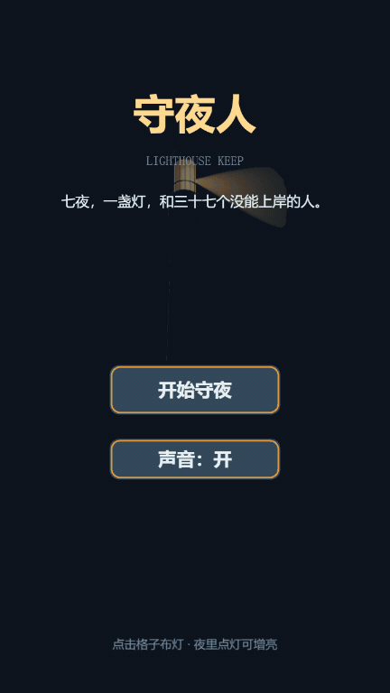

# IdeaToGame

**把一句游戏想法，端到端做成能上架的小游戏 —— 而且是有辨识度的那种。**

从 `一句话` 到 `可提交的 HTML5 包`：创意发散、玩法、视觉身份、自适应音频、表现力、过审自检全自动。
需要人做的只有三件事：确认平台、确认方向、确认风格。

---

## 它解决什么

| | |
|---|---|
| **能出货** | 12 个能力环节（24 个状态阶段）串成流水线，一条命令出包 + 过审清单。5 个平台（CrazyGames / Poki / GameDistribution / Playgama / TapTap），体积按最严口径控制 |
| **值得玩** | 内容丰富度四维门禁（玩法 30 / 叙事 25 / 美学 25 / 音频 20）。机制必须互相咬合，故事必须落地到代码，缺一项直接阻断 |
| **有辨识度** | 五份身份契约（Creative / Visual / Audio / Juice / Experience DNA）+ 5 个结构不同的创意方向 + 相似度分析。DNA 会**编译成运行时配置**，不是文档摆设 |
| **可信** | 六项专项审核（创意/美术/动画/音频/体验/试玩），38 条检查每条都要实测证据：读截图像素、测波形、扫源码、跑试玩。**未验证不算通过** |
| **能自证** | 游戏暴露可驱动的测试接口，用例是声明式的确定性断言（不是敲键盘碰运气）。改完能算出**质量变化**，改坏了能回滚 |

---

## Demo ·《回声摆渡》echo-ferry（v3）

> 雾海上没有方向，只有回声。**敲钟能看见一瞬，也会被黑暗听见。**
> 亮过的地方会留下残影 —— 而残影是「当时」的位置，黑暗里的东西会移动。
> 你打的是幻影。记忆格用完的那一刻，整片海同时熄灭。

3 关、6 个咬合机制、5 条 stem 自适应音乐、22 音效、21 条表现规则。
丰富度 **94/100**，专项审核 38 条证据全过，试玩 4 策略 0 错误。

**核心机制的独特性**：视野不是被给予的，是被借来的；借来的地图会腐烂。

---

## 它怎么证明自己改对了

模板自带可驱动的测试接口（`window.__test`，仅 DEV 生效，不进发行包）与声明式用例：

```json
{ "id": "02-memory-cap",
  "setup":  [{ "type": "set", "patch": { "memory": 5 } }],
  "steps":  [{ "type": "teleport", "c": 5, "r": 2 }, { "type": "move", "dc": 1, "dr": 0 }],
  "assertions": [
    { "path": "delivered", "op": "eq", "value": 1 },
    { "path": "memory", "op": "lte", "valuePath": "memoryMax" }
  ] }
```

`memory <= memoryMax` 而不是写死 `<= 5` —— 换个关卡依然成立，而且能抓住「忘了封顶」这类缺陷。

实测（echo-ferry，8 条用例）：单条 **~150ms**，全量 **~2s**。注入一个「送达奖励突破记忆上限」的缺陷后：

```
02-memory-cap    FAIL → PASS      memory lte memoryMax  期望 5  实际 6
其余 7 条        零回归
判定             ACCEPT           通过率 8/8
```

`iterate.mjs` 负责护栏：改动前留 checkpoint、改动后校验范围（禁止改测试来让测试通过）、跑目标用例 + 全量回归、算质量变化、不通过就回滚。

> 契约见 `references/game-test-schema.md`。ACCEPT 只等于「这批用例证明没修坏」，不等于「玩家会觉得好玩」。

**完整源码 + 可玩单文件都在仓库里**：`examples/echo-ferry/`（双击 `standalone.html` 即玩，无需服务器）。

```bash
cd examples/echo-ferry
open standalone.html          # macOS；Windows 直接双击
# 或从源码跑：npm i && npm run dev
```

### 上一版 Demo ·《守夜人》lighthouse-keep（v2）



七夜塔防，6 个互相咬合的机制，16 条对白，2 个结局。丰富度评分 **98/100**。

---

## 技术流程

```
一句话想法 + 风格参考图 + 目标平台
   │
   ├─ P-1 平台确认 ─────────── G0 人工
   ├─ P0  创意发散 ─────────── 5 个**结构上不同**的方向（交互动词指纹最远点采样）
   │      └─ creative_forge.py    --diverge / --twist / --evaluate（7 维评分 + 相似度）
   ├─ P0.5 创意身份 ────────── creative-dna.json ★ 唯一身份真相源
   ├─ P0  内容蓝图 ─────────── 世界观 / 三幕 / 机制组合 / 每关取舍 / 对白
   │      └─ content_forge.py     idea → 结构化蓝图（脚本给骨架，内容由 Agent 写）
   ├─ P0  审核 ─────────────── R0 规划预审 → RC 丰富度门禁（非 RICH 不许写代码）
   │      └─ richness_check.py    四维打分 + 声明 vs 产物交叉校验
   ├─ P1  项目骨架 + 美术圣经 ── G2 人工确认风格
   ├─ P1  视觉身份 ─────────── 3 套混血风格提案 → visual-dna.json ★
   │      └─ art_director.py     轮廓/材质/光照/镜头/UI/比例/动画/FX + 一致性计划
   ├─ P2  灰盒玩法 ─────────── R1 灰盒预审（不通过禁止生图，省成本）
   │
   ├─ P2  素材生产 ──────────── asset_forge.py   8 种 role 规格 + 提示词 + 一致性锚
   │      └─ gen_assets.py       ComfyUI / RunningHub / 占位，三通道自动降级
   │      └─ 切图 → 抠图 → 图集
   │
   ├─ P2  音频生产 ──────────── audio_forge.py   四层音效 / 音乐 / 对白三份方案
   │      └─ gen_audio.py        程序化合成（始终可用）
   │      └─ YuE2-Studio MCP     音乐生成（可选）
   │      └─ 本地 TTS             对白配音（可选）
   │
   ├─ P2.5 音频系统 ─────────── audio-dna.json ★（stem 分层 + 状态机 + 波形质检）
   │      └─ audio_director.py    --plan / --qc / --emit-ts → audio-config.ts
   │      └─ gen_stems.py         程序化合成 5 条无缝 stem（无外部服务也能跑）
   │
   ├─ P3  表现力 ────────────── juice-plan.json ★（事件 → 14 类效果，按严重度分级）
   │      └─ juice_forge.py       --plan / --emit-ts → juice-config.ts
   ├─ P3  体验设计 ──────────── experience-blueprint.json ★（情绪曲线 + E1–E8）
   ├─ P3  打磨 + 体积审计 ────── 逐平台红线
   ├─ P4  自动化测试 ─────────── qa.mjs / smoke.mjs / playtest.mjs（4 策略真玩）
   ├─ R2前 专项审核 ─────────── specialist_review.py（六项，38 条实测证据，一票否决）
   ├─ P4  审核 ───────────────── R2 终审（REQ 全 PASS 才能交付）
   └─ P4  打包 ───────────────── ship_pack.py    构建 → 审计 → 自检 → zip → 商店素材
```

**贯通全流程的两条线**：`.gamedev/state.yaml`（状态机，唯一真相源）+ `docs/` 下的文件契约（阶段之间不靠对话上下文）。

---

## 实测

| 项目 | 丰富度 | 专项审核 | 结论 |
|---|---|---|---|
| `slime-whack`（v1.6，最优 v1 样本） | **14.5 / 100** | — | `INCOMPLETE` —— 只有循环，无叙事、无角色、无分层音频 |
| `lighthouse-keep`（v2） | **98.0 / 100** | — | `RICH` —— 6 机制全咬合、16 对白落地、22 音效四层 |
| `echo-ferry`（v3） | **94.0 / 100** | **38 条证据全过** | `RICH` —— 结构距离 3/5、4 状态 × 5 stem、试玩 0 错误 |

只能判 PASS 的门禁是废的。这组数据说明它真的在区分。

**测试**：`pytest tests` → 49 passed。端到端用例会真的合成 22 个音效 + 5 条 stem 并做波形质检。

---

## 快速开始

```bash
# 1. 安装（两种都行）
python scripts/install_skill.py --zip dist/idea-to-game-3.0.0.zip   # 自动备份旧版 + 装后自检
# 或：git clone https://github.com/Hejunlong27/idea-to-game.git ~/.workbuddy-ai/skills/idea-to-game

# 2. 建项目（平台、画风一次定好）
python ~/.workbuddy-ai/skills/idea-to-game/scripts/init_project.py \
  --name mygame --idea "一句话想法" \
  --platforms taptap,crazygames --style flat-vector --out D:/games

# 3. 创意发散 → 收敛成身份
python ~/.workbuddy-ai/skills/idea-to-game/scripts/creative_forge.py --project D:/games/mygame --diverge
python ~/.workbuddy-ai/skills/idea-to-game/scripts/creative_forge.py --project D:/games/mygame --evaluate
python ~/.workbuddy-ai/skills/idea-to-game/scripts/creative_forge.py --project D:/games/mygame --dna --pick C1

# 4. 生成内容蓝图并校验
python ~/.workbuddy-ai/skills/idea-to-game/scripts/content_forge.py --project D:/games/mygame --scaffold
python ~/.workbuddy-ai/skills/idea-to-game/scripts/richness_check.py --project D:/games/mygame --stage design

# 5. 视觉身份 / 音频系统 / 表现矩阵
python ~/.workbuddy-ai/skills/idea-to-game/scripts/art_director.py --project D:/games/mygame --propose
python ~/.workbuddy-ai/skills/idea-to-game/scripts/audio_director.py --project D:/games/mygame --plan
python ~/.workbuddy-ai/skills/idea-to-game/scripts/juice_forge.py --project D:/games/mygame --plan
```

依赖：Python 3.9+（pyyaml / pillow / numpy）、Node 18+（模板侧 Phaser 3.90 + Vite 5）。
生图需要本地 ComfyUI 或 RunningHub Key，**两个都没有时自动降级为占位素材，流程不中断**。

---

## 安装与分发

```bash
python scripts/verify_skill.py            # 自检：frontmatter / 目录 / 模板 / 模式库 / 编译 / 断链 / 编码
python scripts/build_skill_package.py     # 打可分发包（自检不过不出包）
python scripts/install_skill.py --zip dist/idea-to-game-3.0.0.zip
```

| 产物 | 体积 | 用途 |
|---|---|---|
| `dist/idea-to-game-3.0.0.zip` | 5.2MB / 346 文件 | 解压到 `~/.workbuddy-ai/skills/` 即用 |

依赖与故障排查见 [`INSTALL.md`](INSTALL.md)。

**为什么不上架技能市场**：平台只认 `SKILL.md` + `references/` `scripts/` `templates/` 三目录，
而本技能的脚本依赖 `assets/template`（整个 Vite 工程模板）与 `assets/data`（模式库），
拍平会直接破坏运行 —— 实测打出来的包能过平台解析，但装上去跑不动。
要做的话需要先重构 80+ 处引用并全量回归，当前判断是不做。详见 [`references/packaging.md`](references/packaging.md)。

## 文档

| 想知道什么 | 看哪 |
|---|---|
| 完整工作流、12 个能力环节细节 | `SKILL.md` |
| v3 升级做了什么 / 没做什么 | `docs/10-upgrade/`（审计 / 架构 / 实施 / 测试 / 迁移 / 功能状态） |
| 创意怎么发散与评分 | `references/creative-identity.md` |
| 视觉身份包含什么 | `references/schemas/visual-dna.schema.json` + `modules/03b-art-director.md` |
| 音频怎么自适应 | `references/audio-emotion-design.md` |
| 事件系统怎么接 | `references/game-event-schema.md` |
| 丰富度怎么打分 | `references/content-depth.md` |
| 机制怎么组合才叫"咬合" | `references/mechanic-vocab.md` |
| 音频怎么分层 | `references/audio-design.md` |
| 审核判据（不可放宽） | `references/crazygames-standard.md` |
| 各阶段文件契约 | `references/contracts.md` |

License: [Apache 2.0](LICENSE)
